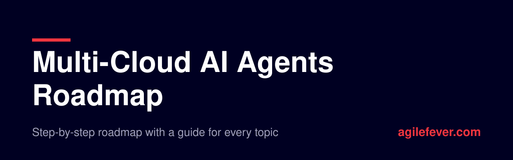

# Multi-Cloud AI Agents Roadmap

> A step-by-step roadmap to build, deploy and operate AI agents on Azure, AWS and Google Cloud, with a blog for every topic

## Table of Contents

- [Who is a Multi-Cloud AI Agents Engineer?](#who-is-a-multi-cloud-ai-agents-engineer)
- [How to Use This Roadmap](#how-to-use-this-roadmap)
- [Step 0: Must Know](#step-0-must-know)
- [Step 1: The Three Platforms Side by Side](#step-1-the-three-platforms-side-by-side)
- [Step 2: Shared Building Blocks](#step-2-shared-building-blocks)
- [Step 3: Azure: Models, RAG and Guardrails](#step-3-azure-models-rag-and-guardrails)
- [Step 4: Azure: Agents, Multi-Agent Systems and Operations](#step-4-azure-agents-multi-agent-systems-and-operations)
- [Step 5: AWS: Models, RAG and Guardrails](#step-5-aws-models-rag-and-guardrails)
- [Step 6: AWS: Agents, Multi-Agent Systems and Operations](#step-6-aws-agents-multi-agent-systems-and-operations)
- [Step 7: Google Cloud: Models, RAG, Agents and Operations](#step-7-google-cloud-models-rag-agents-and-operations)
- [Step 8: Multi-Cloud Design and Capstone](#step-8-multi-cloud-design-and-capstone)
- [Step 9: Certification and Interview Preparation](#step-9-certification-and-interview-preparation)
- [Learn This Roadmap with a Mentor](#learn-this-roadmap-with-a-mentor)
- [License](#license)

### Prepared and maintained by [AgileFever](https://agilefever.com)

### Follow AgileFever

- [LinkedIn](https://www.linkedin.com/company/agilefever/)
- [YouTube](https://www.youtube.com/@AgileFever)
- [X/Twitter](https://x.com/agilefever)
- [Website](https://agilefever.com)

## Learn with AgileFever

- [Multi-Cloud AI Agents BootCamp](https://agilefever.com/bootcamps/multi-cloud-ai-agents-bootcamp/)

---

> **Note: We keep updating this roadmap with new topics and blogs.**

---

### Who is a Multi-Cloud AI Agents Engineer?

A Multi-Cloud AI Agents Engineer builds AI agents that run on the major cloud platforms and knows which platform fits which job. The same ideas repeat on every cloud: models, retrieval, tools, memory, guardrails and operations.

In simple words, this person is:

- **A builder:** deploys models, builds RAG applications, and creates agents and multi-agent systems.
- **An operator:** adds tracing, identity, cost controls and governance so the system is safe to run.
- **A comparer:** explains the trade-offs between Azure, AWS and Google Cloud on cost, governance and ecosystem.

This is why we learn the shared building blocks once, then see how each cloud implements them, and then connect agents across clouds.

### How to Use This Roadmap

This roadmap is designed so that you can follow it in the given order.

- Follow the steps in order. Each step builds on the previous one.
- Inside each step, read the blogs in the given order. Each blog covers one topic in plain words.
- A topic without a link is something to practise or look up in the official documentation of the tool.
- Set up budget alerts on every cloud account before you start. Agent experiments cost real money when left running.
- After every step, ask yourself: "Can I explain this and use it on a small project?" If yes, move on.

Let's get started.

### Step 0: Must Know

Before touching a cloud console, we need to be clear on what an agent is and which parts are the same on every platform.

- [What is Agentic AI? A beginner's guide](https://agilefever.com/what-is-agentic-ai/)
- [Agentic AI vs Generative AI](https://agilefever.com/agentic-ai-vs-generative-ai/)
- [How to start learning AI agents](https://agilefever.com/how-to-start-learning-ai-agents/)
- [Model Context Protocol (MCP) explained for developers](https://agilefever.com/model-context-protocol-explained/)
- Agent-to-Agent protocol (A2A)

### Step 1: The Three Platforms Side by Side

Each cloud has its own agent platform and its own names for similar things. We map them first so the later steps feel familiar.

- [Azure vs AWS vs Google Cloud: which to learn first for AI agents](https://agilefever.com/azure-vs-aws-vs-google-cloud-ai-agents/)
- [Enterprise AI agents on Azure, AWS and Google Cloud: the complete guide](https://agilefever.com/enterprise-ai-agents-on-cloud-guide/)
- [Cloud AI agent skills you will actually build](https://agilefever.com/cloud-ai-agent-skills-azure-aws-google-cloud-courses/)
- [Is the Enterprise AI Agents course right for cloud engineers?](https://agilefever.com/enterprise-ai-agents-course-for-cloud-engineers/)
- Microsoft Foundry, Amazon Bedrock with AgentCore and Google Gemini Enterprise Agent Platform
- Setting up Azure, AWS and Google Cloud accounts with budget alerts

### Step 2: Shared Building Blocks

RAG, agent design, tools, memory, guardrails and evaluation work the same way on every cloud. We learn them once here.

- [Agentic AI architecture: planner, memory, tools and reflection](https://agilefever.com/agentic-ai-architecture-planner-memory-tools-reflection/)
- [Prompt engineering vs context engineering](https://agilefever.com/prompt-engineering-vs-context-engineering/)
- [Single-agent vs multi-agent systems](https://agilefever.com/single-agent-system-vs-multi-agent-system/)
- [AI agent frameworks compared: LangGraph, CrewAI and AutoGen](https://agilefever.com/ai-agent-frameworks-compared/)
- [Prompt injection and guardrails](https://agilefever.com/prompt-injection-guardrails/)
- [How to evaluate an LLM application](https://agilefever.com/evaluate-llm-application/)
- Retrieval Augmented Generation (RAG) and chunking

### Step 3: Azure: Models, RAG and Guardrails

We start with Microsoft Foundry. The goal is a deployed ML model, a foundation model and a RAG application with safety checks.

- [Enterprise AI Agents on Azure: curriculum breakdown](https://agilefever.com/enterprise-ai-agents-on-azure-curriculum-breakdown/)
- Foundry projects, model catalogue and role-based access
- Azure Machine Learning managed online endpoint
- Azure AI Search: vector, hybrid and semantic search
- Content safety and prompt-injection shields
- Evaluators for groundedness, relevance and safety

### Step 4: Azure: Agents, Multi-Agent Systems and Operations

Next we build agents on Azure, connect tools, add human approval, and run the system in production with tracing and cost controls.

- Foundry Agent Service and function tools
- Microsoft Agent Framework in Python
- Sequential, concurrent, handoff and group-chat patterns
- Approval controls on tool calls
- Managed identity, private networking and CI/CD with GitHub Actions
- Tracing with Application Insights
- Quotas, budgets and governance

### Step 5: AWS: Models, RAG and Guardrails

On AWS we use Amazon Bedrock. The same goal applies: a model endpoint, a RAG application and guardrails.

- Bedrock model access and IAM roles
- Bedrock Agents and AgentCore: when to use each
- SageMaker AI real-time endpoint
- Knowledge bases: chunking, embeddings and vector stores
- Bedrock Guardrails and evaluations

### Step 6: AWS: Agents, Multi-Agent Systems and Operations

We build agents with action groups and the Strands Agents SDK, then deploy them on AgentCore and watch them in CloudWatch.

- Action groups and AWS Lambda functions as tools
- Strands Agents SDK in Python
- AgentCore Gateway and MCP servers
- Supervisor and specialist agents, swarm and graph patterns
- AgentCore Runtime, Identity and Memory
- AgentCore Observability with Amazon CloudWatch
- IAM tool-access policies and cost controls

### Step 7: Google Cloud: Models, RAG, Agents and Operations

On Google Cloud we work with the Agent Platform, Gemini and the Agent Development Kit. We cover the whole path in one step, since the ideas now repeat.

- Agent Platform setup, Model Garden and service accounts
- Gemini models and Embeddings with Vector Search
- Model Armor for prompt injection and sensitive data
- Agent Development Kit: agents, tools, sessions and Memory Bank
- Sequential, parallel and loop workflow agents
- Agent Runtime, Cloud Run or GKE: choosing where to deploy
- Agent Identity, Agent Gateway, tracing and cost controls

### Step 8: Multi-Cloud Design and Capstone

Now we put the three clouds together. We choose a cloud for each job, connect agents across clouds with A2A and shared MCP tools, and compare cost and latency.

- [Solution architecture patterns for agentic AI systems](https://agilefever.com/agentic-ai-architecture-patterns-solution-architects/)
- [What a capstone project should prove](https://agilefever.com/agilefever-capstones-what-they-prove/)
- [Comparing cost model, governance and ecosystem across clouds](https://agilefever.com/azure-vs-aws-vs-google-cloud-ai-agents/)
- Agents on different clouds calling each other through A2A
- Tracing a request across clouds

### Step 9: Certification and Interview Preparation

The last step is about proving what you know. We look at the certification paths for each cloud and the interview questions an agent engineer or architect should expect.

- [CCA-F vs cloud AI certifications: which to take first](https://agilefever.com/cca-f-vs-cloud-ai-certifications/)
- [LLM certification: which credentials exist and what they prove](https://agilefever.com/llm-certification/)
- [Solution Architect to AI Solution Architect: interview questions and prep](https://agilefever.com/solution-architect-to-ai-solution-architect-interview-prep/)
- Microsoft, AWS and Google Cloud certification paths
- AI agent interview questions and answers

## Learn This Roadmap with a Mentor

If you want to learn this roadmap in a live cohort, the [Multi-Cloud AI Agents BootCamp](https://agilefever.com/bootcamps/multi-cloud-ai-agents-bootcamp/) builds the same system on all three clouds. The course page lists every module and outcome.

## License

This roadmap is licensed under CC BY 4.0. You may share and adapt it with credit to AgileFever.
